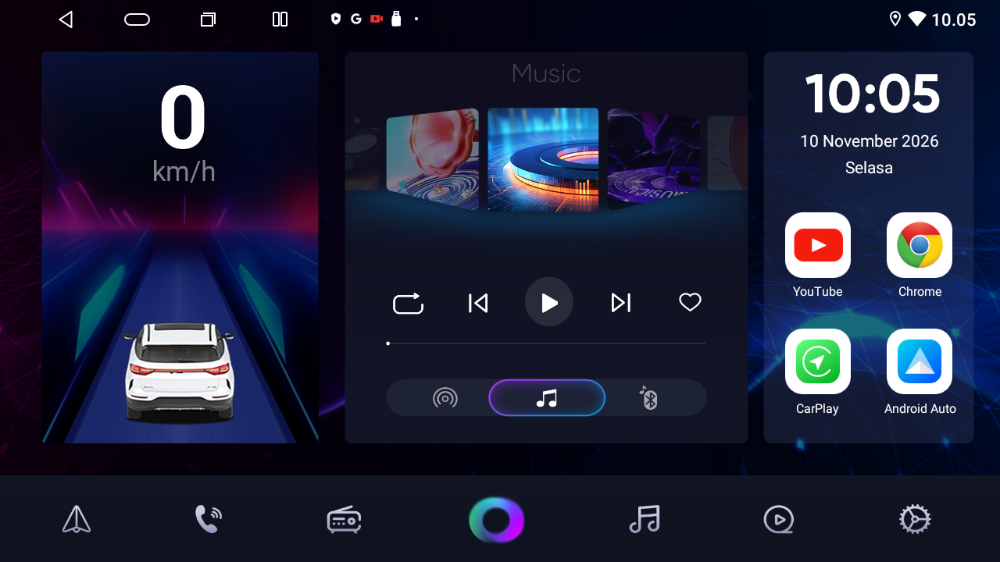
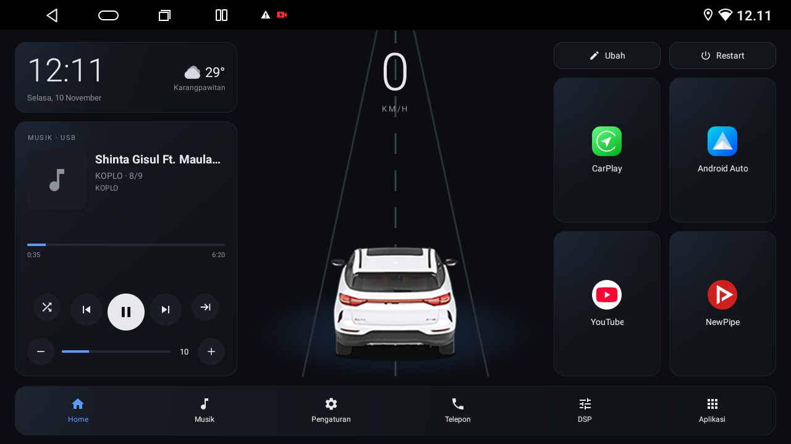
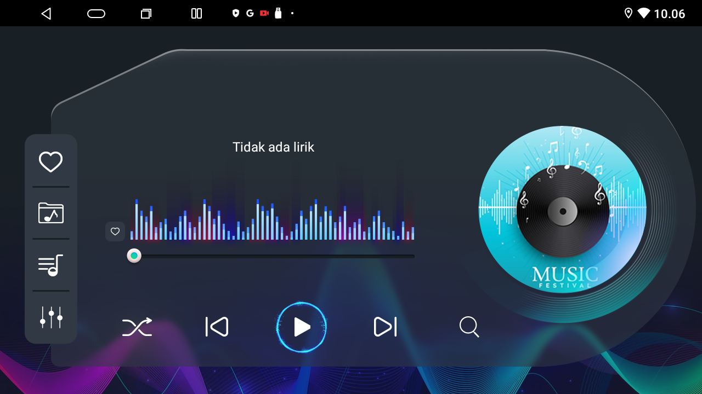
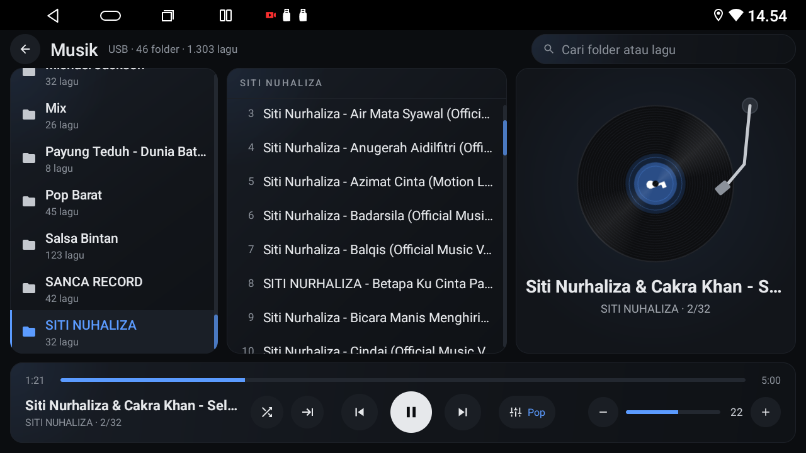
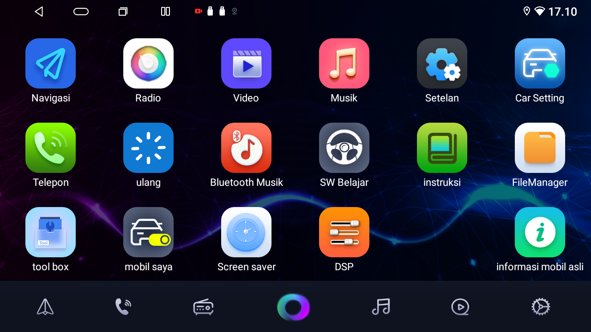
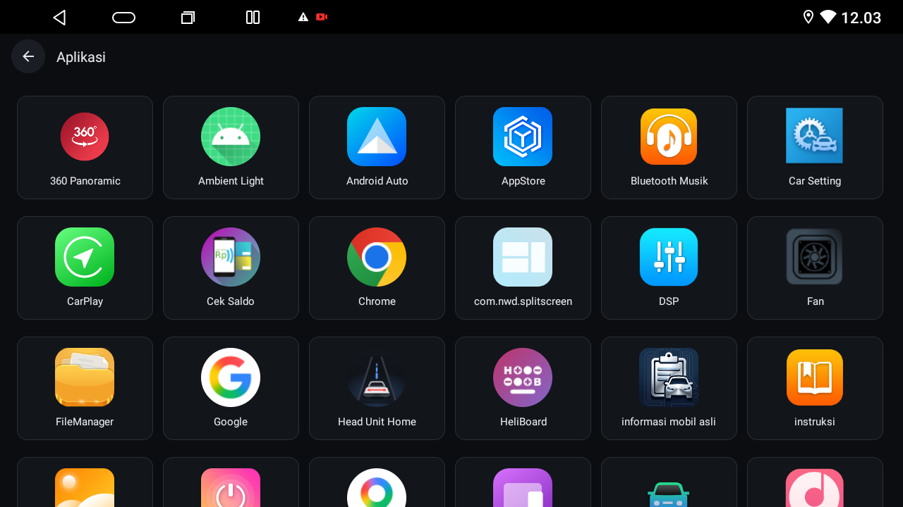
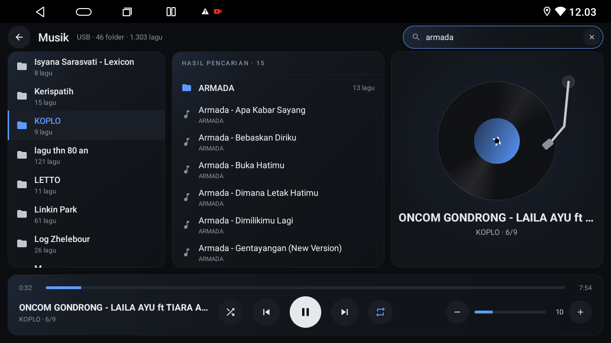
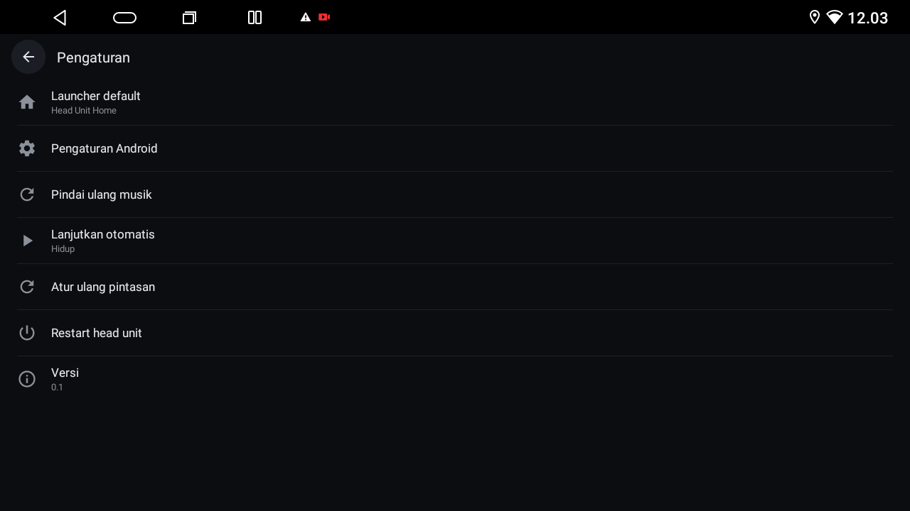
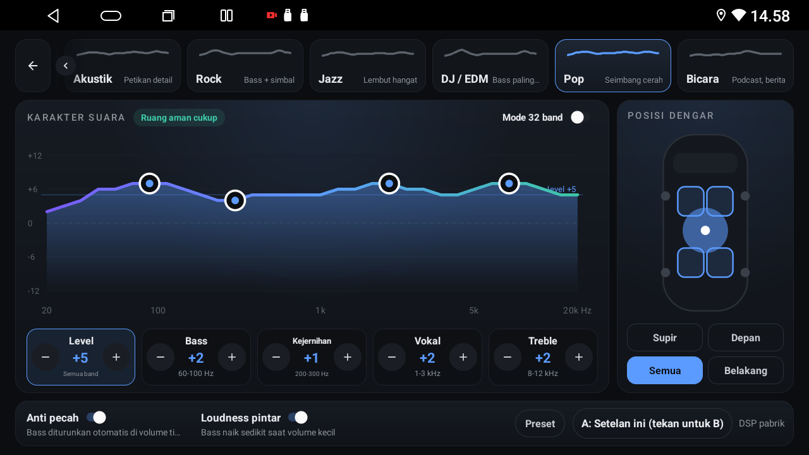

# Android Head Unit Kit

A kit that makes a slow Android car head unit light and usable: Google updates unblocked, debloat, a faster keyboard, EQ tuning, background play, offline maps, and a Custom Home launcher with a Custom Music Player for USB drives and Custom Sound, an own equalizer that drives the factory DSP chip. It contains guides with copy-paste ADB commands, shell scripts that back up and undo, and the source of the launcher app.

**Built from scratch.** Custom Home, Custom Music Player and Custom Sound are original apps written for this kit: plain Java, no third-party launcher or player, no ads, no tracking. The only network use is the Open-Meteo weather request and the unit's own ADB on 127.0.0.1. The guides (debloat, Google updates, EQ, keyboard, background play) are the author's own tested steps on the unit.

## What is in the kit

| Part | What it does |
|---|---|
| [docs/access-and-backup.md](docs/access-and-backup.md) | Connect with ADB, identify the firmware, back up first |
| [docs/security.md](docs/security.md) | ADB over Wi-Fi gives root on this firmware |
| [docs/google-updates.md](docs/google-updates.md) | Lift the Google update ban, stop the update storm |
| [docs/debloat.md](docs/debloat.md) | Free RAM: what to disable, what never to disable |
| [docs/keyboard.md](docs/keyboard.md) | HeliBoard, long-press timing, no autocorrect surprises |
| [docs/eq-tuning.md](docs/eq-tuning.md) | Stop bass distortion in the vendor DSP |
| [docs/background-play.md](docs/background-play.md) | Keep NewPipe and other players alive in the background |
| [docs/launcher.md](docs/launcher.md) | Custom Home (the launcher): features, install, rollback |
| [docs/music-player.md](docs/music-player.md) | Custom Music Player: USB music inside the launcher |
| [docs/eq-tuning.md#custom-sound](docs/eq-tuning.md#custom-sound) | Custom Sound: presets, tone controls, 32 bands, listening position |
| [docs/offline-maps.md](docs/offline-maps.md) | Navigation without mobile data |
| [docs/dvr-and-load.md](docs/dvr-and-load.md) | 360 DVR loop recording and CPU load |
| [scripts/](scripts/) | `backup.sh`, `unblock-google-updates.sh`, `rollback-google-updates.sh`, `debloat.sh` |
| [launcher/](launcher/) | Android Studio style Gradle project of the launcher (plain Java) |
| [AGENTS.md](AGENTS.md) | Instructions for AI coding agents that work on a head unit |

The guide index with the safety rules is [docs/README.md](docs/README.md).

## Tested on

Orca Standard G3 (Android 13, Allwinner T527, factory firmware by NWD), 1280x720 landscape, touch. Other Chinese units with similar firmware may differ: file names, package names and vendor hooks can change. Check the firmware first (see the access guide).

## Quick start

1. Park the car with ACC on and put the unit on your own Wi-Fi hotspot.
2. Connect and back up first:
```
adb connect <unit-ip>:5555
UNIT=<unit-ip>:5555 sh scripts/backup.sh
```
3. Read [docs/README.md](docs/README.md), then do one guide at a time. Log every change and its undo in `backup-<date>/changes.txt`.
4. Optional: build and install the launcher (see [docs/launcher.md](docs/launcher.md)):
```
cd launcher
JAVA_HOME=/opt/homebrew/opt/openjdk@17 ./gradlew testPublicEditionReleaseUnitTest assemblePublicEditionRelease
```

## Custom Sound

Custom Sound replaces the factory DSP screen for daily use. It sends the same 32-band packet as the factory app straight to the DSP chip, so the sound changes at once.

- 14 presets in a scrollable row. Style: Flat Atas, Nendang, Vokal, Datar, Malam, Preset Saya. Genre: Koplo, Dangdut, Akustik, Rock, Jazz, DJ / EDM, Pop, Bicara. Up to 10 own presets.
- Five controls: Level (moves the whole curve, up to +12 dB), Bass, Kejernihan (mud cut), Vokal and Treble.
- 32-band mode with per-band +/- and "all bands" +/-.
- Listening position (driver, front, all, rear), A/B compare, a headroom badge.
- Anti-clip lowers the bass from volume 22 and caps every band at +10 dB. Smart loudness adds a little bass at low volume.
- Open it from the dock or from the Sound button in the music player.

Built-in presets peak between +4 and +10 dB, so there is room left before the +12 dB limit. It needs one setting on Android 13 so a normal app may call the chip; [docs/eq-tuning.md](docs/eq-tuning.md#custom-sound) has the command and the undo.

The launcher also draws its own volume popup (the factory one lives in the factory launcher, which is often stopped), and a left swipe on Home opens All Apps.

## Screenshots

### Before and after

| Factory Home | Custom Home |
|---|---|
|  |  |

| Factory Music Player | Custom Music Player |
|---|---|
|  |  |

| Factory All Apps | Custom All Apps |
|---|---|
|  |  |

### Gallery

| Custom Home | Custom Music Player |
|---|---|
|  |  |

| Search | Settings |
|---|---|
|  |  |

| All apps | Custom Sound |
|---|---|
|  |  |

- Custom Home: clock, weather, speed with road and car, music card, six tiles and the dock.
- Custom Music Player: folders, songs and the vinyl card with the now-playing bar.
- Search: folders first, then songs, across the whole USB library.
- Settings: default launcher, shortcuts, music rescan, restart and version.
- All apps: six-column grid of every launchable app. Swipe left on Home opens it.
- Custom Sound: style and genre presets, five tone controls plus a whole-curve level, 32-band mode, listening position, anti-clip and smart loudness. It drives the factory DSP chip directly.

Screenshots were taken on the tested unit before the car image was replaced by the original drawing in this repo.

## Credits

- Weather data: [Open-Meteo](https://open-meteo.com/) (CC BY 4.0). Attribution: "Weather data by Open-Meteo.com".

## License

MIT, see [LICENSE](LICENSE).
