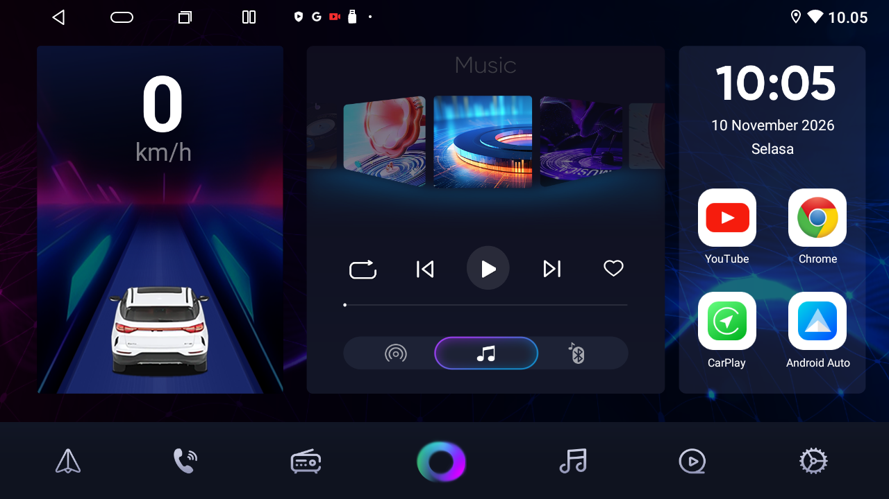
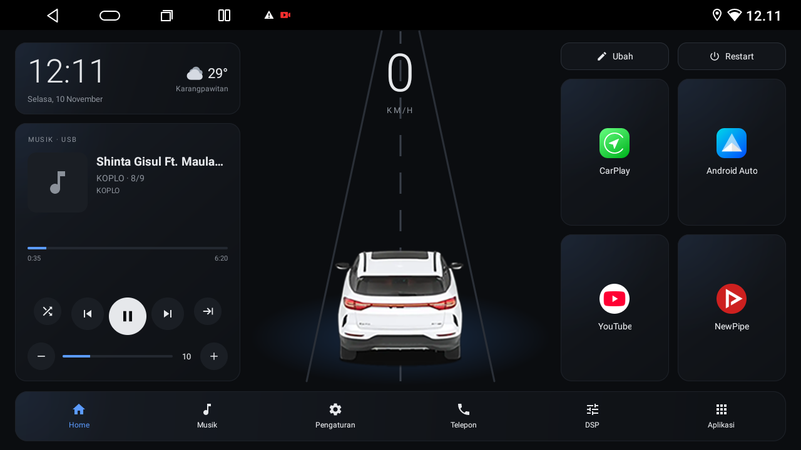
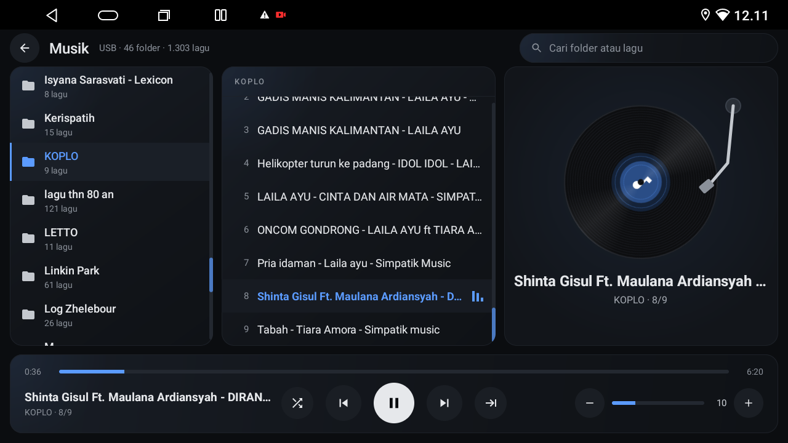
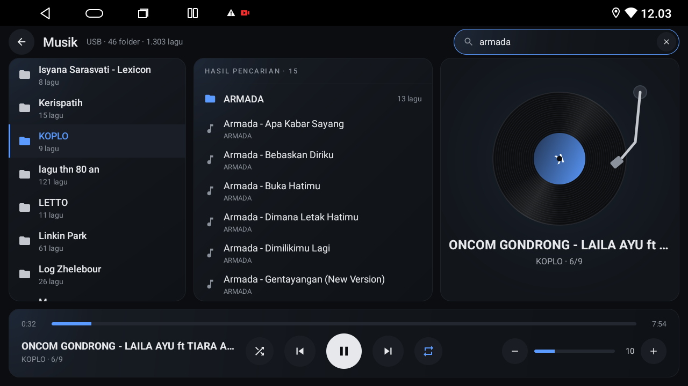
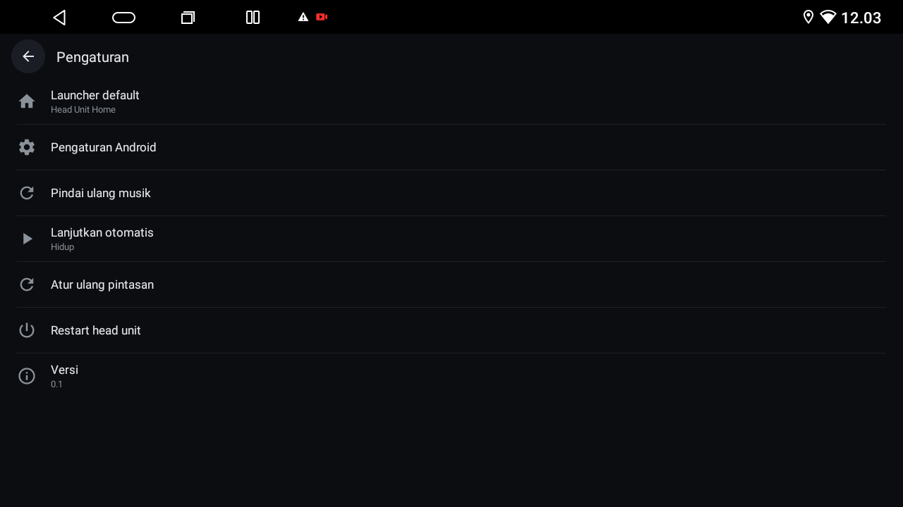
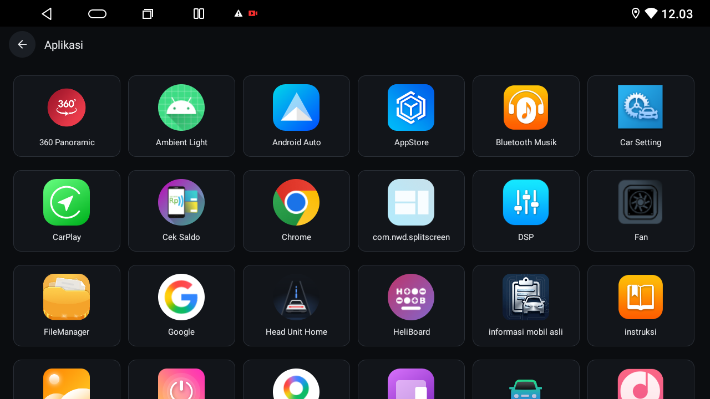

# Android Head Unit Kit

A kit that makes a slow Android car head unit light and usable: Google updates unblocked, debloat, a faster keyboard, EQ tuning, background play, offline maps, and a custom Home launcher with a USB music player. It contains guides with copy-paste ADB commands, shell scripts that back up and undo, and the source of the launcher app.

## What is in the kit

| Part | What it does |
|---|---|
| [docs/access-and-backup.md](docs/access-and-backup.md) | Connect with ADB, identify the firmware, back up first |
| [docs/security.md](docs/security.md) | ADB over Wi-Fi gives root on this firmware |
| [docs/google-updates.md](docs/google-updates.md) | Lift the Google update ban, stop the update storm |
| [docs/debloat.md](docs/debloat.md) | Free RAM: what to disable, what never to disable |
| [docs/keyboard.md](docs/keyboard.md) | HeliBoard, long-press timing, no autocorrect surprises |
| [docs/eq-tuning.md](docs/eq-tuning.md) | Stop bass distortion in the vendor DSP |
| [docs/background-play.md](docs/background-play.md) | Keep NewPipe and other players alive in the background |
| [docs/launcher.md](docs/launcher.md) | The Head Unit Home launcher: features, install, rollback |
| [docs/music-player.md](docs/music-player.md) | The USB music player inside the launcher |
| [docs/offline-maps.md](docs/offline-maps.md) | Navigation without mobile data |
| [docs/dvr-and-load.md](docs/dvr-and-load.md) | 360 DVR loop recording and CPU load |
| [scripts/](scripts/) | `backup.sh`, `unblock-google-updates.sh`, `rollback-google-updates.sh`, `debloat.sh` |
| [launcher/](launcher/) | Android Studio style Gradle project of the launcher (plain Java) |
| [AGENTS.md](AGENTS.md) | Instructions for AI coding agents that work on a head unit |

The guide index with the safety rules is [docs/README.md](docs/README.md).

## Tested on

Orca Standard G3 (Android 13, Allwinner T527, factory firmware by NWD), 1280x720 landscape, touch. Other Chinese units with similar firmware may differ: file names, package names and vendor hooks can change. Check the firmware first (see the access guide).

## Quick start

1. Park the car with ACC on and put the unit on your own Wi-Fi hotspot.
2. Connect and back up first:
```
adb connect <unit-ip>:5555
UNIT=<unit-ip>:5555 sh scripts/backup.sh
```
3. Read [docs/README.md](docs/README.md), then do one guide at a time. Log every change and its undo in `backup-<date>/changes.txt`.
4. Optional: build and install the launcher (see [docs/launcher.md](docs/launcher.md)):
```
cd launcher
JAVA_HOME=/opt/homebrew/opt/openjdk@17 ./gradlew testReleaseUnitTest assembleRelease
```

## Screenshots

| Factory Home | Head Unit Home |
|---|---|
|  |  |

| Music player | Search |
|---|---|
|  |  |

| Settings | All apps |
|---|---|
|  |  |

- Home: clock, weather, speed with road and car, music card, four tiles and the dock.
- Music player: folders, songs and the vinyl card with the now-playing bar.
- Search: folders first, then songs, across the whole USB library.
- Settings: default launcher, shortcuts, music rescan, restart and version.
- All apps: six-column grid of every launchable app.

Screenshots were taken on the tested unit before the car image was replaced by the original drawing in this repo.

## Credits

- Weather data: [Open-Meteo](https://open-meteo.com/) (CC BY 4.0). Attribution: "Weather data by Open-Meteo.com".

## License

MIT, see [LICENSE](LICENSE).
