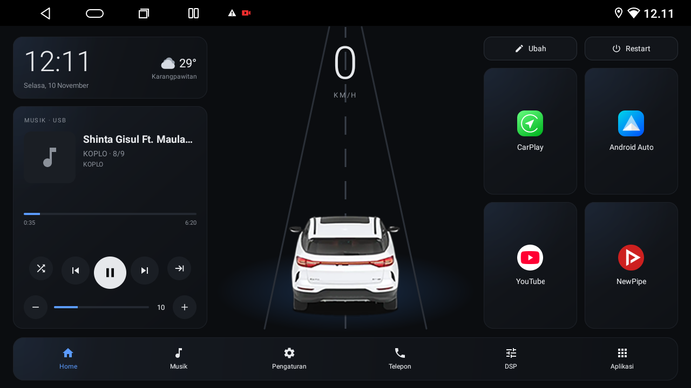
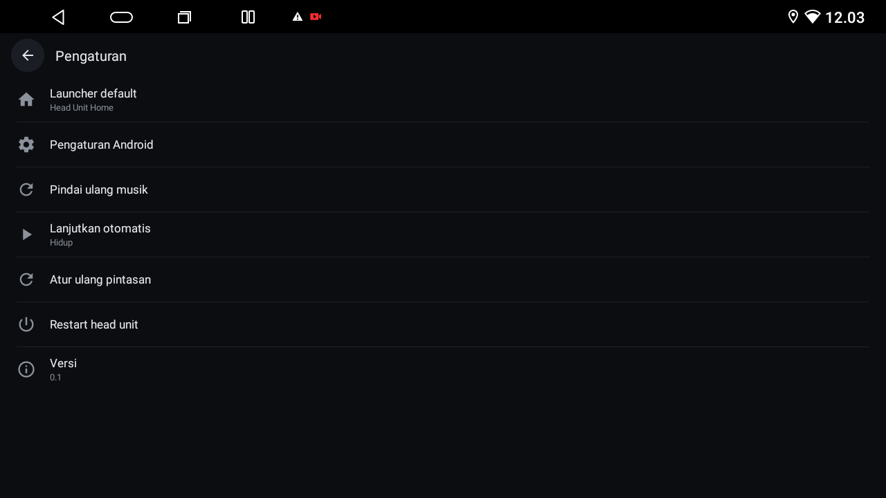
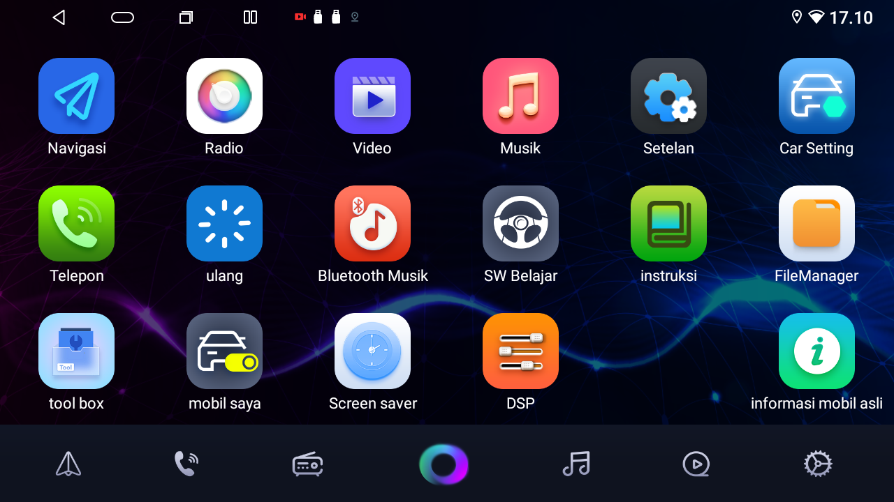
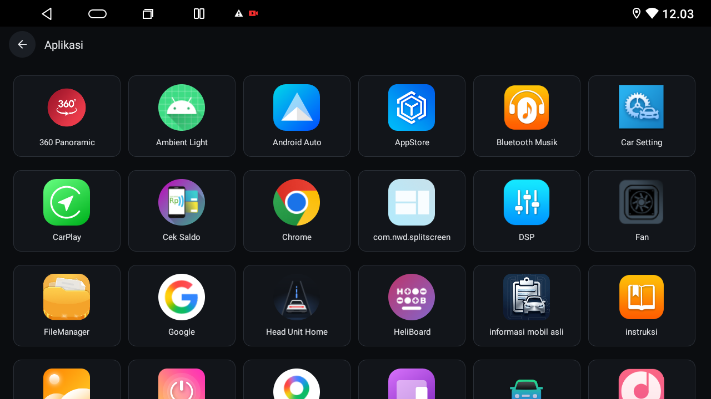

# Custom Home (launcher)

## Problem
The Factory Home is heavy and the unit is slow. Custom Home is a light replacement: plain Java, no AndroidX, about 120 KB APK. The Factory Home stays installed as a fallback.

Built from scratch: Custom Home is an original app written for this kit, with no third-party launcher, no ads and no tracking. The only network use is the Open-Meteo weather request and the unit's own ADB on 127.0.0.1.

## Symptoms
- The Factory Home takes a long time to draw and uses about 160 MB of RAM.
- You want speed, a music card, six shortcuts and a dock on one screen.

## Screenshots





| Factory All Apps | Custom All Apps |
|---|---|
|  |  |

Screenshots were taken on the tested unit before the car image was replaced by the original drawing in this repo.

## Features
### Home
- Clock (24 h) and date in the device language.
- Weather from Open-Meteo (no key). The last result is cached and shown at once on start. It refreshes every 30 minutes while Home is visible, at most once per 10 minutes, and when the first GPS fix arrives. The place name comes from the platform Geocoder with administrative prefixes such as "Kecamatan" removed. When the cache is older than 60 minutes a small "updated HH:mm" line appears.
- GPS speed from `GPS_PROVIDER` (1 s updates). It shows "--" when there has been no fix for 5 s.
- The road animation scrolls its center line in proportion to the speed and stops at 0 km/h.
- Turn tilt: above 10 km/h a smoothed bearing change of more than 4 degrees per second tilts the car and the road to the left or right.
- Music card: shows another app only while that app is playing (through its media session, which needs notification access). Otherwise it shows the Custom Music Player.
- Volume row on the music card: minus and plus buttons and a level bar that drive the unit's MCU volume. Holding a button repeats every 150 ms.
- Edit and Restart buttons. Restart asks for confirmation and warns when the car is moving.
- Six shortcut tiles (defaults: CarPlay, Android Auto, YouTube, NewPipe, Maps, 360 camera). Long-press a tile, or tap it in edit mode, to pick any launchable app. A default app that is not installed shows "Choose app". Settings, "Reset shortcuts" restores the six defaults. The full layout shows a grid of 2 columns by 3 rows, the compact layout one row of six small tiles.
- Dock: Home, Music, Phone, DSP, Settings, Apps.

### Car image
- Settings, "Car image": use the built-in drawing, choose your own picture, or remove it. A chosen picture is copied to `filesDir/car_custom.png` as a PNG, scaled so the longest side is at most 800 px, and its transparency is kept. Home shows it instead of the built-in drawing and reloads it when the file changes.
- A transparent rear-view PNG of about 352x382 px fits best: the car in the lower part of the picture, with free space above it for the speed number.
- You can also push a PNG with root ADB (replace `car.png` with your file):
```
adb push car.png /data/local/tmp/car.png
adb shell "cat /data/local/tmp/car.png > /data/data/com.agung.headhome/files/car_custom.png"
adb shell 'U=$(stat -c %u /data/data/com.agung.headhome); chown $U:$U /data/data/com.agung.headhome/files/car_custom.png'
```
Delete the file (or use "Remove custom image") to return to the built-in drawing.

### Settings
- Default launcher: lists every Home activity and sets the choice with `cmd package set-home-activity` and `setprop persist.nwd.launcher.default`.
- Android settings, reset shortcuts, rescan music, resume playback automatically (on by default), restart head unit and version.

### All apps
- Six-column grid of every launchable app. The list is cached and rebuilt when a package is added, removed or changed.

### Split screen
- All activities are resizeable. Below 900 dp of width Home switches to a compact layout (clock and weather, road and car, music card, one row of six tiles, dock). Dock labels are hidden below 560 dp.

### Icon and splash
- Adaptive launcher icon with a monochrome variant, and an Android 12 splash screen with the same dark background.

The Custom Music Player is described in [Custom Music Player](music-player.md).

## How it talks to the factory firmware

| Purpose | Hook |
|---|---|
| Home key | The factory firmware sends the key to the package in system property `persist.nwd.launcher.default`. `cmd package set-home-activity` alone does not change it. |
| Volume | Read `Settings.System` keys `mcu_system_volume` and `mcu_max_volume`. Set it by broadcasting `com.nwd.action.ACTION_REQUEST_SET_SYSTEM_VOLUME` with the int extra `extra_volume`. |
| USB music | Drives are mounted at `/mnt/media_rw/<drive>`. They are not under `/storage` and MediaStore does not list them, so the app reads the files directly. |
| Restart and set default launcher | A small built-in ADB client (`LocalAdb`) talks to the unit's own adbd on `127.0.0.1:5555` and runs `shell:reboot` or the set-home commands. The RSA key is generated on first use and kept in the app's private files. |
| Factory apps | Dock shortcuts open the factory music, phone and audio-settings activities (`.home_horizontalActivity`). |

## Build
```
cd launcher
JAVA_HOME=/opt/homebrew/opt/openjdk@17 ./gradlew testPublicEditionReleaseUnitTest assemblePublicEditionRelease
```
The APK is written to `launcher/app/build/outputs/apk/publicEdition/release/app-publicEdition-release.apk` (signed with the debug key). Set `sdk.dir` in `launcher/local.properties` to your Android SDK.

There are two build flavors with the same application id (`com.agung.headhome`), so one installs over the other and keeps its settings. `publicEdition` is the default and is what this repository builds. `owner` adds the resource folder `launcher/app/src/owner/res` (ignored by git) on top of the app. If you want your own car picture compiled in, you have two options: use Settings, "Car image" (no rebuild), or create `launcher/app/src/owner/res/drawable/car.png` (same resource name as the built-in `car.xml`, so it replaces it) and run:
```
JAVA_HOME=/opt/homebrew/opt/openjdk@17 ./gradlew assembleOwnerRelease
```
The APK is then in `launcher/app/build/outputs/apk/owner/release/`. A clean clone without `src/owner` still builds `assemblePublicEditionRelease`.

## Install
```
adb install -r launcher/app/build/outputs/apk/publicEdition/release/app-publicEdition-release.apk
adb shell pm grant com.agung.headhome android.permission.ACCESS_FINE_LOCATION
adb shell pm grant com.agung.headhome android.permission.POST_NOTIFICATIONS
adb shell cmd notification allow_listener com.agung.headhome/com.agung.headhome.MediaListener
adb shell cmd package set-home-activity com.agung.headhome/.MainActivity
adb shell setprop persist.nwd.launcher.default com.agung.headhome
```
The first Home press right after installing can still open the Factory Home; the second opens Custom Home.

## Check it worked
Press Home: the launcher opens. Reboot and press Home again. `adb shell getprop persist.nwd.launcher.default` prints `com.agung.headhome`.

## Rollback
```
adb shell cmd package set-home-activity com.android.launcher/com.android.launcher2.Launcher
adb shell setprop persist.nwd.launcher.default com.android.launcher
```

## Known limits
- Speed and turns come from GPS only. Expect a delay of 1 to 2 s, and turns need more than about 10 km/h. There is no CAN box.
- Restart and the default launcher setting use the unit's local ADB service on port 5555. See [Security](security.md).
- The USB index refresh compares only the root's last modified time and entry count. Changes deep inside a drive need "Rescan music" in Settings.
- Steering-wheel buttons and split screen have not been verified on the unit yet.

## Safety
- Restart is allowed at any speed. Do not use it when you may need the reverse camera.
- Keep the factory Home installed so you can go back.
