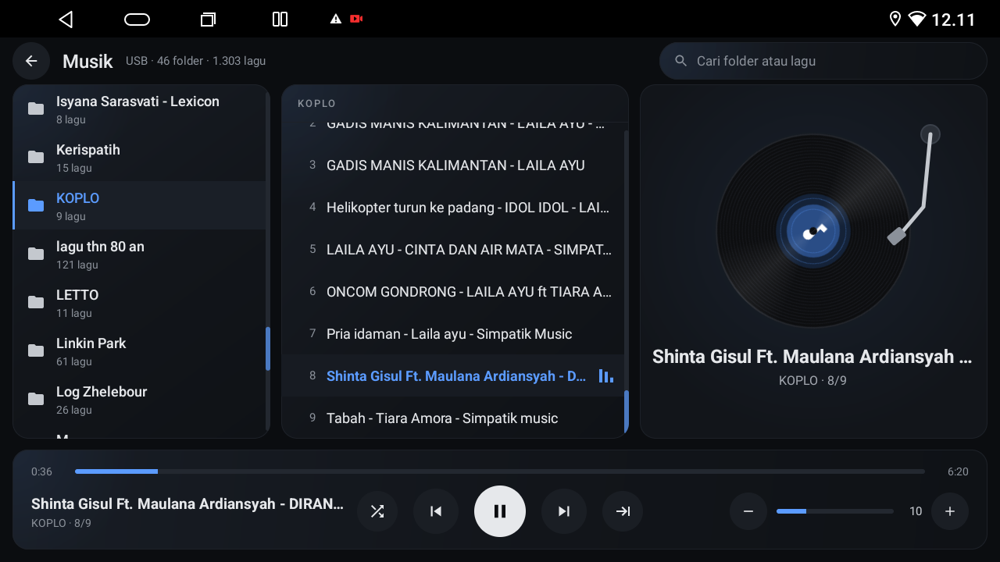
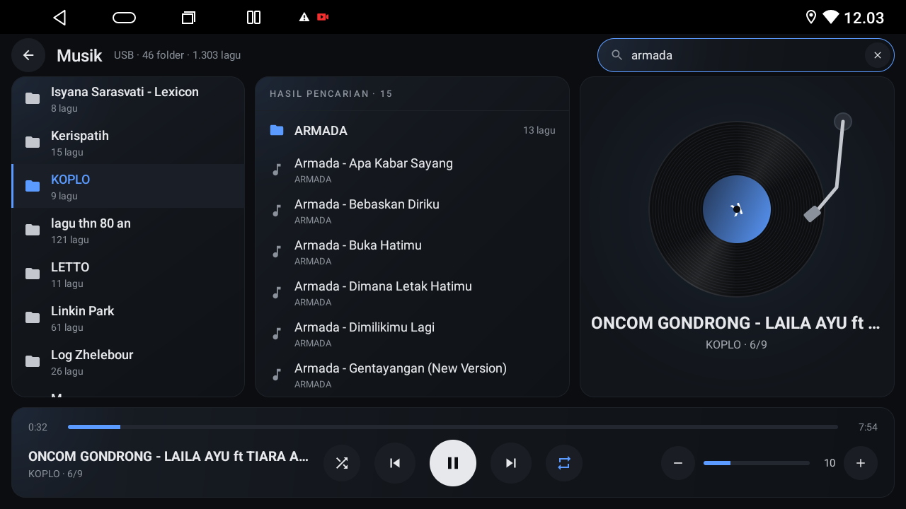

# Music player

## Problem
The factory music app is heavy (about 227 MB RSS) and plain. USB drives are not visible to Android's media library on this firmware, so ordinary music apps cannot find the files.

## Symptoms
- Music apps show no files from the USB drive.
- MediaStore has no audio rows for the drive.

## Screenshots





Screenshots were taken on the tested unit before the car image was replaced by the original drawing in this repo.

## How it works
The launcher includes a USB player. The drives are mounted at `/mnt/media_rw/<name>`, are world-readable, and are not under `/storage`. The player scans every readable directory below `/mnt/media_rw` and indexes audio files (mp3, flac, m4a, aac, ogg, opus, wav; extensions are matched case-insensitively). A folder is a directory that directly contains audio. A drive with no audio, such as a DVR drive, adds nothing.

- Folders are in natural, case-insensitive order by path ("01" before "2" before "10"). Songs in a folder are in natural order by file name.
- Repeat button, four modes in this order: continue (play folder by folder and stop after the last song of the last folder), repeat all (after the last folder start again at the first; the default), repeat folder, repeat one.
- Shuffle works inside the current folder: a random order of that folder, then the next folder in order, which is shuffled too. The repeat modes apply on top.
- Previous restarts the song when more than 3 seconds have played, otherwise it goes to the previous song, across folder boundaries.
- Search matches folder names first, then song names, ignoring case and diacritics, at most 200 results.
- The file, position, repeat mode and shuffle are saved. After a launcher start the player can resume by itself after 3 seconds when it was playing before (Settings, "Resume playback automatically", on by default).
- The player publishes a framework MediaSession (play, pause, next, previous, seek), so steering-wheel and other media buttons reach it. Audio focus is respected.
- The index is cached in the app's files directory and reused while each drive root's last modified time and entry count match. The root list is polled every 15 seconds while the service runs. Changes deep inside a drive are not seen: use Settings, "Rescan music".

## Volume
The real volume is the MCU volume. The launcher reads `Settings.System` `mcu_system_volume` (maximum in `mcu_max_volume`, 40 on the tested unit) and sets it with a broadcast:
```
adb shell "settings get system mcu_system_volume; settings get system mcu_max_volume"
adb shell "am broadcast -a com.nwd.action.ACTION_REQUEST_SET_SYSTEM_VOLUME --ei extra_volume 24"
```

## Check it worked
```
adb shell ls /mnt/media_rw/
adb shell "ls /mnt/media_rw/<drive> | head"
```
Open Music in the dock: the folders appear. Start a song, press Home, press the steering-wheel next button.

## Rollback
Use the factory music app (`com.nwd.android.music.ui`). Nothing on the drive is changed by the player.

## Safety
- The player only reads the drive. Do not rely on it to copy or edit files.
- Steering-wheel button handling has not been verified on the unit yet.
